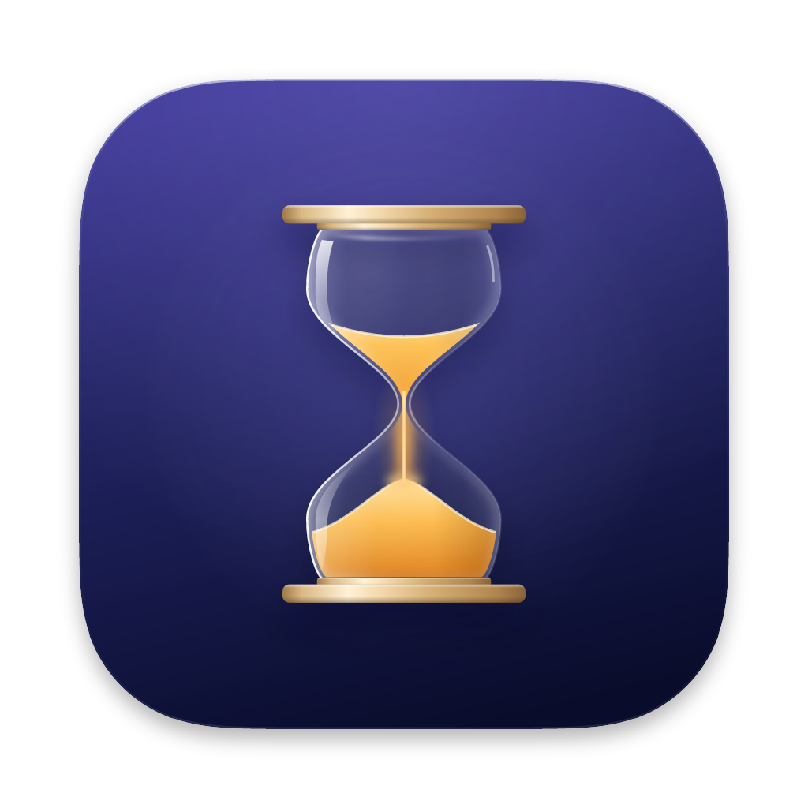

# Sandglass

A fast, native macOS app for culling **JPG + NEF** photo pairs.

Open a folder, step through the photos, flip between the JPG and the NEF with
one key, flag what you want to keep, then save everything you flagged into a
folder you choose. Version 4 is a ground-up rewrite: a native AppKit app with a
Liquid Glass interface, five layouts, much faster loading, and a rebuilt zoom
engine.

<p align="center">
  
</p>

---

## What's new in 4.0

- **Native macOS shell.** A real unified toolbar with window title and subtitle
  (folder · position · flagged · seen), a split view with a floating glass
  sidebar and an inspector, full menus with every shortcut listed, Open Recent,
  Settings (⌘,), undo for flags (⌘Z), full screen, drag and drop (onto the window,
  onto the Dock icon, and out of the thumbnail strip into Finder), and
  "Open With → Sandglass" for folders, JPGs and NEFs.
- **Five layouts** (⌘1–⌘5): Filmstrip, Sidebar on Left, Sidebar on Right, Grid,
  and Photo Only — plus **Compare**, which shows a photo's JPG and NEF side by side
  with zoom and pan locked together.
- **Glass design.** Liquid Glass for everything that floats over the photo, a
  translucent window backdrop (the desktop shows through, frosted and tinted —
  Fluent's Acrylic), Fluent-style cards, hover states and accent focus rings.
- **Much faster loading.** Photos decode at the size of the window, NEFs show the
  camera's own embedded full-size JPEG instead of being demosaiced, neighbours are
  prepared in the background, and thumbnails load only for what is on screen.
- **Bounded memory.** Small LRU caches with byte budgets that scale with your
  Mac's RAM, at most two full-resolution bitmaps at a time, and caches released
  under memory pressure.
- **Rebuilt zoom and navigator.** See [Zoom and the navigator](#zoom-and-the-navigator)
  for the bugs that were fixed.
- **Flags are remembered** per folder between launches (Settings can turn this off).
- **A new icon:** a translucent glass hourglass on an indigo tile.

## What it does

- **One tile per photo, not per file.** `DSC_0001.JPG` and `DSC_0001.NEF` are one
  shot. Files with no sibling still appear, marked as such.
- **Switch variants** with `T`. With only one variant on disk the app tells you
  instead of failing silently.
- **Flag per variant.** Flagging records *which* file you want:
  flag while viewing the JPG → the `.JPG` is exported; flag while viewing the NEF
  → the `.NEF`; flag both → both files.
- **Export** copies or moves exactly the flagged files to a folder you choose.
  Nothing is ever overwritten — a collision becomes `DSC_0001 2.NEF`. Copies on
  the same volume are instant APFS clones, and the copy runs off the main thread.
- **Metadata on demand** in the inspector (`I`): camera, lens, exposure, dates,
  colour profile, GPS, the NEF's embedded preview size, and file facts. The photo
  overlay shows the exposure at a glance (`H` hides it).
- **Photos are never altered.** No tint, filter or colour transform is applied;
  bitmaps keep the file's colour space and are colour-matched to the display.

## Requirements

- macOS 26 or later (the Liquid Glass APIs require it)
- Xcode 26+ / Swift 6.2+ to build
- No third-party dependencies

## Build and run

```bash
./Scripts/build-app.sh
```

```bash
open dist/Sandglass.app
```

`./Scripts/build-app.sh debug` builds a debug app; `./Scripts/build-app.sh release universal`
builds for Intel and Apple silicon. `./Scripts/make-dmg.sh` packages a universal,
ad-hoc signed (not notarised) DMG.

Open a shoot straight from a terminal:

```bash
dist/Sandglass.app/Contents/MacOS/Sandglass ~/Pictures/Wedding
```

## Using it

1. Open a folder: the button on the welcome screen, `⌘O`, File ▸ Open Recent, or
   drop a folder (or a photo, which opens its folder) anywhere on the window or on
   the Dock icon.
2. Move through the photos with the arrow keys. `T` flips JPG ↔ NEF.
3. `F` flags what is on screen, `B` keeps both, `1`/`2` keep only one. `⌘Z` undoes.
4. `⌘E` shows exactly what will be exported, then asks where.

### Layouts

| Layout | | Best for |
| --- | --- | --- |
| Filmstrip | ⌘1 | The classic culling view: thumbnails on a glass shelf under the photo |
| Sidebar on Left | ⌘2 | A native glass sidebar of thumbnails |
| Sidebar on Right | ⌘3 | The same, on the other side |
| Grid | ⌘4 / `G` | A contact sheet with adjustable thumbnail size; `Return` or double-click opens a photo |
| Photo Only | ⌘5 / `Tab` | Nothing but the photo |
| Compare | `C` | JPG and NEF side by side, zoom and pan locked together |

The inspector (`I`, ⌥⌘I, or the toolbar) opens on the right in any layout.
Layout, inspector and thumbnail size are remembered.

### Keyboard

| Key | Action |
| --- | --- |
| `←` `→` · `J` `K` · `Space` / `⇧Space` | Previous / next photo |
| `↑` `↓` | Previous / next (by row in Grid) |
| `Home` `End` | First / last photo |
| `T` | Switch between JPG and NEF (⌘J / ⌘K pick one) |
| `F` | Flag the variant on screen |
| `B` | Flag both JPG and NEF |
| `1` / `2` | Keep only the JPG / only the NEF |
| `X` / `⌫` | Clear this photo's flags (⇧⌘⌫ clears all) |
| `⌘Z` / `⇧⌘Z` | Undo / redo a flag change |
| `Z` / double-click | Fit ↔ 100% (or 200%, in Settings) |
| `+` `−` `0` | Zoom in / out by standard steps / fit (⌥⌘0: actual size) |
| `C` | Compare JPG and NEF |
| `G` | Grid ↔ the previous layout |
| `Tab` | Show or hide thumbnails |
| `I` / `M` | Show or hide the inspector |
| `H` | Show or hide the photo info overlay |
| `Esc` | Leave Compare / Grid, or zoom back to fit |
| `⌘O` `⌘R` `⌘E` | Open folder / reload / export |
| `⌃⌘F` | Full screen |
| `⌘/` | Keyboard reference |

Single-key shortcuts are listed in the menus too; they act only on the main
window and never while you are typing.

### Mouse and trackpad

- **Scroll wheel** zooms about the pointer. Rolling away from you zooms in,
  whatever your natural-scrolling setting is.
- **Pinch** (or ⌘/⌥-scroll) zooms on a trackpad; **two-finger scroll** pans with
  momentum; **two-finger double-tap** (smart zoom) toggles fit ↔ 100%.
- **Drag** pans when zoomed in.
- In the **navigator** (bottom right, shown while zoomed in): drag the rectangle,
  click elsewhere to jump, scroll to zoom, double-click to fit.
- Right-click a thumbnail to flag, reveal in Finder or open it; drag a thumbnail
  out to copy the file somewhere else.

## Zoom and the navigator

The canvas is a layer holding the decoded bitmap, placed by a single transform, so
zoom and pan run at display refresh rate. All of its geometry comes from a
`Viewport` (`Sources/Sandglass/Core/Viewport.swift`) that stores the framing in
resolution-independent terms — a magnification on top of fit, and the normalised
point of the photo at the centre of the pane — and derives everything else. It is
pure Swift and covered by tests that run on any platform.

Bugs fixed by the rewrite:

- **Wheel zoom ran backwards** for anyone using natural scrolling (the macOS
  default), and a fast flick could produce a zero or negative zoom factor. Zoom
  now follows the physical direction and every step is a bounded, multiplicative
  factor, so zooming in and out by the same amount returns exactly to the start.
- **The photo jumped when the sharper bitmap arrived.** The old centre was stored
  in pixels of the *previous* bitmap. The framing is now resolution-independent.
- **Resizing the window or toggling a panel reset the zoom**, flashed a spinner and
  re-decoded the whole file. Now the magnification and centre are kept (at 100% you
  stay at 100%) and nothing is re-decoded.
- **Scrolling in a sheet or popover zoomed the photo behind it** — a global event
  monitor ignored which window an event belonged to. The canvas now receives events
  the normal AppKit way.
- **The navigator lagged and misled.** Its rectangle was fed through throttled
  SwiftUI state, it was covered by the "loading full resolution" chip, grabbing the
  rectangle made it jump under the pointer, and panoramas were cropped so the
  rectangle sat on the wrong region. The navigator is now drawn with layers and
  updated on every frame, keeps the photo's exact aspect ratio, remembers where you
  grabbed it, shades everything outside the visible region, and moves above the
  control bar if the window is too narrow for both.
- **Aliasing at fit**: a full-resolution bitmap was shrunk with nearest-neighbour
  filtering. At fit the screen-sized rendition (downsampled by ImageIO) is shown;
  every pixel is swapped in once zoom magnifies past it, drawn crisply with
  nearest-neighbour so 100% and beyond show real pixels.

## Why it is fast

- **Decode to the size on screen.** ImageIO scales JPEGs while decoding (in the DCT
  domain), so a 24 MP file reaches a window-sized bitmap in a fraction of the time
  and a sixth of the memory of a full decode. The size follows the pane, in steps,
  so resizing does not re-decode.
- **Use the camera's JPEG for NEFs.** Nikon stores a full-size JPEG rendering in
  every NEF. `RawPreviewLocator` walks the TIFF structure (IFDs, SubIFDs, the
  maker-note preview) to find it without decoding anything, and decoding it costs
  the same as a JPEG file. The raw data is only developed if a camera embedded a
  small preview and you zoom past it (Settings can turn that off).
- **Never show the 160 px EXIF thumbnail.** Decodes always come from the image
  proper, which is what keeps previews sharp.
- **Decode in the background, eagerly.** All decoding happens off the main thread
  and is forced to complete there, so the first draw never stalls the interface.
- **Prepare what is next.** The neighbours (mostly in the direction you are moving)
  and the other variant are decoded at low priority while you look; full resolution
  is decoded after a short pause on a photo, so zooming is instant. Holding an
  arrow key never queues work: anything no longer wanted is cancelled.
- **Thumbnails only for what is visible.** The browser is an `NSCollectionView`
  that recycles tiles; each tile requests its thumbnail when it appears and cancels
  it when it scrolls away, and identical requests share one decode.
- **Fine-grained updates.** State is `@Observable`; a flag change redraws one tile
  and the controls, not the window.

### A note on NEF previews

Some files carry no preview macOS can read. Sandglass says *"No preview
available"* and offers **Open in Default App**; flagging and exporting still work.

## Design

Liquid Glass (macOS 26) is used for everything that floats over the photo — the
control bar, the photo overlay, the navigator, the filmstrip shelf — so the
picture stays the brightest thing on screen. The window backdrop is translucent
glass by default; Settings offers a tint slider, a solid colour, or a picture of
your own (with dimming), and a neutral tone (black, charcoal, mid grey) behind the
photo for colour-critical judgement. From Microsoft's Fluent design come the
quieter conventions: layered cards with a hairline stroke, a hover highlight on
everything clickable, a clear type ramp, and an accent-coloured focus ring around
the selected thumbnail. Flags are amber throughout.

## How files are recognised

Pairing is by **base name, case-insensitively**: `DSC_0001.JPG` and `dsc_0001.nef`
are one shot. Numeric suffixes are not folded together — `DSC_0002-2.NEF` is its
own shot, and `IMG_1` and `IMG_10` stay separate. Managed extensions are `jpg`,
`jpeg` and `nef`; other formats are ignored, and only the chosen folder is scanned.

## Project layout

```
Sources/Sandglass/
  Core/           platform-independent: builds and is tested on Linux too
    Shot.swift              file kinds, flags, shots, pairing, folder scanning
    Library.swift           the culling session (@Observable): navigation, flags, sessions
    Exporter.swift          export planning and the off-main copy/move engine
    Viewport.swift          zoom/pan geometry behind the canvas and navigator
    ZoomInput.swift         scroll-wheel, trackpad and pinch interpretation
    NavigatorGeometry.swift navigator mapping and drag behaviour
    RawPreviewLocator.swift finds embedded JPEG previews inside NEF/TIFF files
    LRUCache.swift          cost-bounded LRU cache
    Commands.swift          commands, layouts, the key map and shortcut reference
    SessionStore.swift      remembers flags and position per folder
    AppSettings.swift       preferences (@Observable, UserDefaults)
    ObservationLoop.swift   lets AppKit controllers follow @Observable state
    Formatting.swift        percentages, shutter speeds, sizes…
  Imaging/        ImageIO decoding, preview/thumbnail/metadata stores
  Viewer/         the canvas, navigator and photo pane
  Browser/        the NSCollectionView thumbnail browser
  Window/         window controller, toolbar, split view, layouts, backdrop
  Interface/      SwiftUI: design system, control bar, inspector, export, settings
  App/            entry point, app delegate, menus, key routing
  Diagnostics/    --report / --inspect / --bench
Tests/SandglassTests/
  Core/           runs on macOS and Linux
  App/            decoding, orientation, canvas rendering, preview pipeline, metadata
Tests/Fixtures/   a sample shoot, orientation fixtures, synthetic NEFs (+ generator)
Resources/Icon/   the icon's SVG sources and a 1024 px preview
Scripts/          build-app.sh, make-dmg.sh, make-icon.py
```

## App icon

The icon is designed as SVG (`Resources/Icon/Sandglass.svg`, plus a bolder
`Sandglass-small.svg` for 16–64 px) and packed into `Resources/Sandglass.icns`,
which is committed. To regenerate it:

```bash
python3 -m pip install --user --only-binary=:all: resvg-py
```

```bash
python3 Scripts/make-icon.py
```

The output is deterministic, and the script verifies the `.icns` it writes. The
tile follows Apple's icon grid (an 824 px continuous-corner squircle on a 1024 px
canvas, with the standard shadow).

## Verification

On a Mac:

```bash
swift test
```

The core suite also runs on Linux (`swift test` there builds just `Core/`). It
covers pairing, flags, export planning and real copy/move/no-overwrite on disk,
the culling session (navigation, variant fallback, flag rules, session
persistence, reload), the viewport (fit, anchored zoom, drift, resizing, bitmap
swaps, pan bounds, zoom steps), scroll interpretation (wheel direction under
natural scrolling, bounded factors), navigator geometry, the NEF preview locator
(including big-endian files, maker-note previews, corrupt lengths, truncated files
and a fuzz test), the LRU cache, the key map and settings.

The macOS suite decodes real files — including a genuine Nikon NEF and synthetic
NEFs with embedded previews, checked pixel by pixel for orientation — compares
orientation handling with Apple's, renders the canvas through its layer tree to
prove that zoom magnifies real pixels with no smoothing, that a sharper bitmap
replaces a softer one without moving, and that resizing keeps the framing, and runs
the preview pipeline end to end.

CI (`.github/workflows/ci.yml`) builds, tests and packages the app on a macOS 26
runner on every push and uploads `Sandglass.app` as an artifact.

Diagnostics that report facts about a folder of your own:

```bash
dist/Sandglass.app/Contents/MacOS/Sandglass --report ~/Pictures/Wedding
```

```bash
dist/Sandglass.app/Contents/MacOS/Sandglass --inspect ~/Pictures/Wedding
```

```bash
dist/Sandglass.app/Contents/MacOS/Sandglass --bench ~/Pictures/Wedding
```

`--report` runs scan → flag → export into a temporary folder and verifies what
landed; `--inspect` shows what each file decodes to (screen-sized and full), from
where (JPEG, camera preview, raw decode) and how long it took; `--bench` times cold
decodes at the sizes the app requests.
